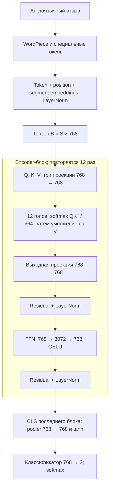

# ДЗ №1. Анализ узких мест и ускорение BERT-base на CPU

## 1. Выбор модели и контекст применения

Выбрана NLP-модель [textattack/bert-base-uncased-SST-2](https://huggingface.co/textattack/bert-base-uncased-SST-2): BERT-base с головой бинарной классификации, настроенный на SST-2. Вход — англоязычное предложение из отзыва о фильме; выход — вероятности отрицательной и положительной тональности. SST-2 содержит эти два класса, без нейтрального; перенос на русскоязычные отзывы или другие предметные области здесь не предполагается.

Рассматривается онлайн-инференс в сервисе, который показывает пользователю тональность короткого отзыва. Обучение выполняется отдельно и не входит в бюджет ответа. Исходный вариант: FP32, один запрос за проход, модель постоянно находится в памяти, градиенты и dropout выключены.

Приняты следующие требования сценария:

| Параметр | Проектное значение |
|---|---|
| Нагрузка | В среднем 10 запросов/с, пик 20 запросов/с в течение 5 минут |
| Суточный объём | 864 000 запросов при среднем 10 запросов/с за сутки |
| Вход | Один текст до 128 WordPiece-токенов, включая специальные; типичные длины 32–128 |
| Длинные запросы | Явно отклоняются или направляются в отдельную очередь; скрытого обрезания нет |
| Ответ | Два значения вероятности и метка класса |
| Задержка | p95 полного серверного ответа ≤100 ms при пиковой нагрузке |
| Бюджет модели | Ориентир p95 forward ≤60 ms; остальное — токенизация, очередь, сериализация |
| Качество | Падение accuracy относительно исходного checkpoint ≤1 процентного пункта |

Бюджеты отдельных стадий — ориентиры: сумма их p95 не равна автоматически p95 всего запроса. Успех определяется непосредственным измерением полной задержки. CPU выбран для сервиса с умеренным потоком и небольшими батчами: не требуется выделять GPU, а данные уже находятся в памяти CPU. Это инженерный выбор для данного сценария, а не доказательство минимальной стоимости.

## 2. Целевая аппаратная платформа

Целевая машина — **AWS EC2 c6i.xlarge**, Linux x86-64, **4 vCPU, 8 GiB RAM**, процессор семейства Intel Xeon Ice Lake, без GPU. Эти параметры опубликованы [AWS](https://aws.amazon.com/ec2/instance-types/c6i/). vCPU нельзя автоматически считать независимым физическим ядром; конфигурацию CPU и SMT нужно зафиксировать при испытании.

Один процесс модели получает проектный лимит **2 GiB RSS**; оставшаяся память предназначена для ОС, сервиса и резерва. Внутрипроцессные потоки проверяются в вариантах 1, 2 и 4. Бесконтрольное увеличение числа процессов копирует веса и создаёт конкуренцию за CPU и память.

Для данного размера AWS не приводит на использованной странице гарантированную DRAM bandwidth. Поэтому 10/20/40 GB/s далее — только значения для анализа чувствительности. Сетевой предел «до 12,5 Gbps» и EBS «до 10 Gbps» из спецификации нельзя подставлять вместо bandwidth оперативной памяти. При коротком текстовом входе сеть и диск предположительно не определяют время тёплого forward; загрузка весов с EBS важна при холодном старте.

Аппаратного лимита энергии в сценарии нет. Снижение числа операций может уменьшить энергию на запрос, но для облачной VM оно не измерено; практические метрики — CPU-seconds/request и число инстансов для соблюдения SLO.

## 3. Архитектура и ключевые размерности

Согласно [конфигурации](https://huggingface.co/textattack/bert-base-uncased-SST-2/blob/main/config.json), используются 12 encoder-блоков, скрытая размерность `d=768`, FFN `f=3072`, 12 голов attention с размерностью `64`, словарь `V=30522`, до 512 позиций, два типа сегментов. Анализируется стандартный `BertForSequenceClassification` с pooler и двумя выходами.

Основная идея BERT — двунаправленный encoder: токены одного текста обмениваются информацией во всех направлениях. В каждом блоке идут multi-head self-attention, residual и LayerNorm, затем FFN с GELU, residual и LayerNorm. Описание архитектуры: [Devlin et al.](https://arxiv.org/abs/1810.04805); детали блоков и pooler: [реализация авторов](https://github.com/google-research/bert/blob/master/modeling.py).

`B` — размер батча, `S` — фактическая длина с padding. Q/K/V после разбиения имеют форму `B × 12 × S × 64`; scores каждой головы — `S × S`. FFN обрабатывает каждый токен отдельно, но с большой внутренней шириной. Pooler обрабатывает только CLS. При инференсе dropout отключён. Это классификация за один проход: здесь нет авторегрессионной генерации и растущего KV-cache.

### Параметры и память весов

Для стандартного BERT с bias и LayerNorm:

- Embeddings: `Vd + 512d + 2d + 2d = 23 837 184` параметра.
- Один блок: `4d² + 2df + (4d + f + d) + 4d = 7 087 872`.
- 12 блоков: `85 054 464`.
- Pooler: `d² + d = 590 592`.
- Голова: `2d + 2 = 1 538`.
- Всего: **109 483 778 параметров**, или **417,65 MiB** весов FP32.

Большинство параметров сосредоточено в encoder; embeddings занимают ещё около 90,93 MiB FP32. Но для одного текста embedding lookup обращается лишь к выбранным строкам, поэтому размер таблицы не равен объёму её чтения на каждый запрос. Размер весов также не равен RSS: runtime хранит активации, аллокаторы, упакованные матрицы и иногда копии исходных весов.

## 4. Вычислительные затраты и bottlenecks

Считаем матричные операции одного encoder-блока:

| Часть | MAC |
|---|---:|
| Q, K, V и выходная проекция attention | `4BSd²` |
| FFN: две линейные проекции | `2BSdf` |
| QKᵀ и умножение вероятностей на V | `2BS²d` |

Для `f=4d` весь encoder требует `L · B · (12Sd² + 2S²d)` MAC. **Один MAC принят за два FLOPs**. Softmax, GELU, LayerNorm, bias, residual, pooler и классификатор в эту оценку не включены: это приближение матричной арифметики, а не полный счёт всех инструкций.

| Длина S, B=1 | Encoder, GMAC | Encoder, GFLOPs | FFN, доля MAC | QKᵀ + AV, доля MAC |
|---:|---:|---:|---:|---:|
| 32 | 2,7368 | 5,4736 | 66,21% | 0,69% |
| 64 | 5,5113 | 11,0226 | 65,75% | 1,37% |
| 128 | 11,1736 | 22,3473 | 64,86% | 2,70% |
| 512 | 48,3184 | 96,6368 | 60,00% | 10,00% |

Оставшиеся MAC относятся к Q/K/V и выходной проекции. Таким образом, квадратичная сложность attention не делает его главным источником арифметики при коротких текстах: при `S=128` FFN и проекции вместе дают **97,30% MAC**. Из равенства `12Sd² = 2S²d` получается `S=6d=4608`, что превышает поддерживаемую длину BERT-base. При этом доля MAC не равна доле времени.

### Перечень узких мест и причин

| Узкое место | Причина в выбранной модели и на CPU | Как отличить при профилировании |
|---|---|---|
| FFN и линейные проекции | Большие плотные веса, 12 последовательных блоков; короткие матрицы хуже используют параллелизм CPU | Время MatMul/Gemm и доля FFN в operator trace |
| Чтение весов и конкуренция за cache/DRAM | Матрицы encoder содержат около 339,74 MB FP32; они не помещаются целиком в небольшой CPU cache | Cache misses и bandwidth при разных B, числе потоков и INT8 |
| Padding | Обычная dense-реализация считает и padding-токены; маска attention не удаляет матричные операции | Сравнение одинаковых текстов при padding до 512, 128 и своего bucket |
| Накладные расходы runtime | На коротких входах заметны запуски операторов, промежуточные буферы, перестановки и синхронизация потоков | Сравнение времени операторов и полного forward, unfused/fused графов |
| Очередь и oversubscription | Несколько запросов и BLAS-потоков конкурируют за 4 vCPU; хвост задержки растёт раньше среднего | p95/p99 под нагрузкой, CPU utilisation, глубина очереди |
| Токенизация и cold start | WordPiece выполняется на CPU; чтение и упаковка 418 MiB весов важны при запуске | Раздельные таймеры токенизации, загрузки и тёплого forward |

Это **аналитически обоснованные кандидаты**, а не измеренное ранжирование по latency. При `B=1,S=128` FFN определяет арифметику; какая часть фактического времени уходит на вычисления, память и runtime, зависит от kernel и реализации.

Для иллюстрации памяти: один материализованный attention-тензор `B·12·S²` FP32 при `S=128` занимает **0,75 MiB**, при `S=512` — **12 MiB**. FFN-тензор `B·S·3072` занимает соответственно **1,5 и 6 MiB**. В памяти могут одновременно находиться scores, probabilities и другие буферы; fused attention может не материализовать полную матрицу. При инференсе не нужно сохранять все активации 12 слоёв для backward, поэтому умножение этих чисел на 12 не даёт корректного пика RSS.

Грубая модель времени: `T ≥ max(F/P_eff, D/BW_eff)`, где `F` — FLOPs, `P_eff` — эффективная производительность CPU, `D` — фактический трафик памяти. При условном однократном чтении всех FP32 матриц encoder `D≈339,74 MB`; для предполагаемой bandwidth 10/20/40 GB/s одно такое чтение заняло бы **33,97/16,99/8,49 ms**. Это иллюстрация чувствительности: cache, повторные чтения, упаковка и активации меняют `D`. Эти значения не являются измерениями или надёжной нижней границей latency выбранной VM.

## 5. Системные ограничения и их приоритет

Главное ограничение — одновременно выдержать хвост задержки и поток запросов. Для одного последовательного worker загрузка `ρ=λ·E[T_service]`. При пике `λ=20/с` и целевом запасе `ρ≤0,6` среднее полное обслуживание должно быть **≤30 ms**. Даже соблюдение p95 forward 60 ms само по себе этого не гарантирует. При нарушении условия потребуются более быстрый вариант, иной режим параллелизма или дополнительные реплики.

Второе ограничение — 2 GiB RSS процесса, включая runtime. Веса FP32 сами по себе помещаются, но несколько worker и копии графов могут исчерпать бюджет. Третье — сохранение качества: потеря не более 1 п.п. accuracy и проверка отрицаний, коротких неоднозначных отзывов и длинных текстов у границы лимита. Ограничение длины — часть API; его нельзя менять ради красивого benchmark без проверки семантики.

Диск и сеть вторичны для тёплого сервиса с небольшими текстами, но cold start должен замеряться отдельно; readiness открывается после загрузки и прогрева. Сервис не должен принимать неограниченную очередь: при перегрузке нужны ограничение очереди и явный отказ либо масштабирование.

## 6. Гипотезы ускорения и инженерные компромиссы

### 6.1. Убрать лишний padding, настроить потоки и исполнение

Для входов до 128 токенов padding до 512 увеличивает матричную работу в **4 раза**. Удаление лишнего padding сохраняет содержательные токены и корректную маску, не требует переобучения. Buckets 32/64/128 уменьшают вычисления для коротких текстов; при `B=1` можно подавать фактическую длину, если runtime эффективно поддерживает динамические формы. Цена buckets — несколько вариантов форм и усложнение маршрутизации; padding иногда выгоден ради более эффективного kernel. Ускорение по MAC не обещает такого же ускорения по времени.

Включить режим инференса, держать одну загруженную модель, сравнить 1/2/4 потока; экспортировать в ONNX Runtime CPU и проверить доступные fusion для attention, LayerNorm и GELU. Fusion сокращает промежуточные записи и overhead, но не отменяет математическую работу FFN. Он полезен при заметной доле мелких операторов, менее полезен при доминировании уже оптимального GEMM. Применимость зависит от совпадения подграфов; после обновления экспортера оптимизация может перестать срабатывать. Проверять operator trace, логиты и accuracy.

### 6.2. Динамическая INT8-квантизация линейных слоёв

Первый кандидат — Q/K/V, выходная проекция attention и обе матрицы FFN. Меньшие веса сокращают трафик памяти, INT8 GEMM может выполнять арифметику быстрее. LayerNorm и softmax разумно оставить в FP32. Для transformer ONNX Runtime рекомендует рассматривать dynamic quantization; масштабы активаций вычисляются во время исполнения, добавляя overhead. Наличие и выгода INT8 kernel проверяются на выбранном CPU.

Если все линейные матрицы, включая pooler и голову, хранить в INT8, а embeddings, bias и LayerNorm оставить FP32, идеализированный объём весов равен **172,96 MiB** против **417,65 MiB**, то есть уменьшение примерно **2,41 раза**, а не 4. В расчёт не входят scales, zero points, alignment и упакованные копии; фактический размер артефакта и RSS нужно измерять отдельно.

Условия применения: поддерживаемые kernels и допустимая потеря accuracy. При очень коротком входе overhead динамического квантования может съесть выигрыш; при деградации отдельных слоёв их можно оставить FP32. Цена — численные ошибки, отдельная проверка экспорта и зависимость от backend. Static INT8 требует репрезентативной калибровки; если PTQ не сохраняет качество, QAT добавит обучение. Снижение размера весов само по себе не доказывает ускорение.

### 6.3. Дистилляция 12 → 6 encoder-блоков

Teacher — выбранный BERT-base; student — шестислойный BERT той же ширины `d=768,f=3072`, с тем же tokenizer и двухклассовой головой. Можно инициализировать блоки копированием слоёв teacher 2/4/6/8/10/12, затем обучить student на SST-2 train с истинными метками и мягкими ответами замороженного teacher:

`L = (1−α) CE(y, softmax(z_s)) + α T² KL(softmax(z_t/T) || softmax(z_s/T))`.

Здесь `z_t,z_s` — логиты; начальная гипотеза `T=2, α=0,5`, затем подбор на отдельной tuning-части train. KL направлен от распределения teacher к student; при инференсе teacher не нужен. Подход передачи мягких распределений описан у [Hinton et al.](https://arxiv.org/abs/1503.02531).

При одинаковых B и S MAC encoder сокращаются ровно вдвое. Но весь student содержит **66 956 546 параметров** (около **255,42 MiB FP32**): embeddings и голова не уменьшаются. Это предложенная архитектура; её нельзя выдавать за уже обученный DistilBERT. [DistilBERT](https://arxiv.org/abs/1910.01108) служит примером дистилляции encoder на этапе pretraining, а не гарантией качества этого student.

Метод полезен при недостаточном выигрыше runtime и INT8 и наличии данных/бюджета обучения. Цена — отдельный training pipeline, подбор гиперпараметров, возможные потери на сложных конструкциях, поддержка версий teacher/student. Двукратное уменьшение encoder MAC даёт верхний ориентир, но не обещает двукратного end-to-end speedup: токенизация и серверные расходы сохраняются.

### 6.4. Структурный pruning FFN или блоков

Удаление половины каналов FFN с физическим изменением матриц `768→1536→768` уменьшает FFN MAC вдвое. При `S=128` encoder сохраняет `1−0,5·0,6486≈0,6757` исходных MAC, то есть теоретический выигрыш **около 1,48 раза** по матричной работе. Нужны отбор каналов и дообучение, желательно с teacher. Удалять только attention heads менее приоритетно: FFN остаётся; кроме того, нужно реально сжимать проекции.

Метод имеет смысл, если backend эффективно исполняет полученные dense-размеры и качество восстанавливается. Простое зануление весов без sparse kernel и изменения структуры обычно не сокращает dense GEMM. Цена структурного pruning — потеря ёмкости, нестандартная конфигурация и более сложные экспорт и поддержка.

### 6.5. Microbatching и reduced precision

Батчи 2/4 могут переиспользовать веса и улучшить эффективность GEMM. Но при пике всего 20 запросов/с средний интервал поступления — 50 ms: ожидание полного батча опасно для SLO 100 ms. Проверять только microbatching с максимальным ожиданием, например 2 ms, и немедленным выполнением неполного батча. Цена — очередь, padding внутри батча и больший пик памяти; для офлайн-обработки метод намного привлекательнее.

FP16/BF16 снижает размер чисел, но на выбранном CPU результат определяется поддержкой формата в ISA и runtime; преимуществ GPU Tensor Cores здесь нет. Поэтому reduced precision — дополнительный эксперимент, а не первый выбор. При отсутствии быстрых kernels конвертации способны замедлить исполнение; численную устойчивость проверяют отдельно. FlashAttention-подобные методы также не главный приоритет: здесь мала S и основная арифметика находится в FFN и проекциях.

## 7. Как проверить гипотезы и выбрать решение

Проверка нужна для будущего внедрения, а не для подтверждения выдуманных измерений. Порядок вариантов: FP32 baseline → сокращённый padding/настройка потоков → optimized FP32 runtime → INT8 → шестислойный student → student INT8. Менять по одному фактору; не перемножать независимо ожидаемые speedup, поскольку методы затрагивают одни и те же расходы.

1. Зафиксировать CPU/SMT, ОС, число потоков, лимит памяти, версии библиотек, revision весов/tokenizer, формы входов и seed. Одинаковые тексты и правила длины использовать во всех вариантах.
2. На целевой VM сделать 50 прогревочных проходов на каждую форму; затем не менее 1000 проходов для B=1 и S=32/64/128, три независимых повтора. Отдельно измерить токенизацию, forward и cold start; RSS брать как пик процесса с весами и буферами, а не размер файла модели.
3. Снять CPU operator profile для репрезентативных форм. Проверить, какие MatMul остались FP32, какие fusion сработали, не доминирует ли упаковка или синхронизация. Профилирование выполнять отдельно от итоговых таймингов из-за его overhead.
4. Провести open-loop тест 10 и 20 запросов/с по 5 минут с фиксированным распределением длин и полным учётом очереди. Отчёт: offered/completed QPS, p50/p95/p99 полной задержки, ошибки, глубина очереди, CPU и RSS. Не скрывать отказы из статистики; closed-loop тест не заменяет проверку заданного входящего потока.
5. Для настройки student выделить tuning-часть только из train; SST-2 validation (872 примера) оставить для финального сравнения с исходной моделью. Проверить accuracy и парные изменения ошибок, дополнительно macro-F1 и заранее выбранные срезы. У SST-2 test скрыты метки; его нельзя локально использовать как размеченный набор.

Падение accuracy считается в процентных пунктах: например, 92% → 91% — это 1 п.п. На 872 примерах это около девяти решений, поэтому небольшая разница может быть статистическим шумом. Нужен парный bootstrap для разницы accuracy и проверка дополнительной репрезентативной выборки перед эксплуатацией. Сравнение с baseline не устанавливает достаточность абсолютного качества сервиса.

Кандидат принимается при p95 полной задержки ≤100 ms на 20 запросах/с, отсутствии перегрузки/отказов в заданной нагрузке, RSS ≤2 GiB и потере accuracy ≤1 п.п. Если несколько вариантов проходят, выбрать самый простой в сопровождении. Если не проходит ни один, потребуется изменить ресурсный бюджет или масштабировать сервис; аналитические FLOPs не доказывают выполнение SLO.

**Итоговый инженерный выбор:** начать с устранения лишнего padding и настройки CPU runtime, затем проверить динамическую INT8 для линейных слоёв. Эти шаги адресуют основную арифметику и трафик весов без отдельного обучения student. Шестислойная дистилляция — следующий вариант с большей ценой разработки, но с прямым уменьшением последовательной глубины. Главный компромисс — выигрыш времени и памяти против качества, затрат на обучение и усложнения поддержки.
